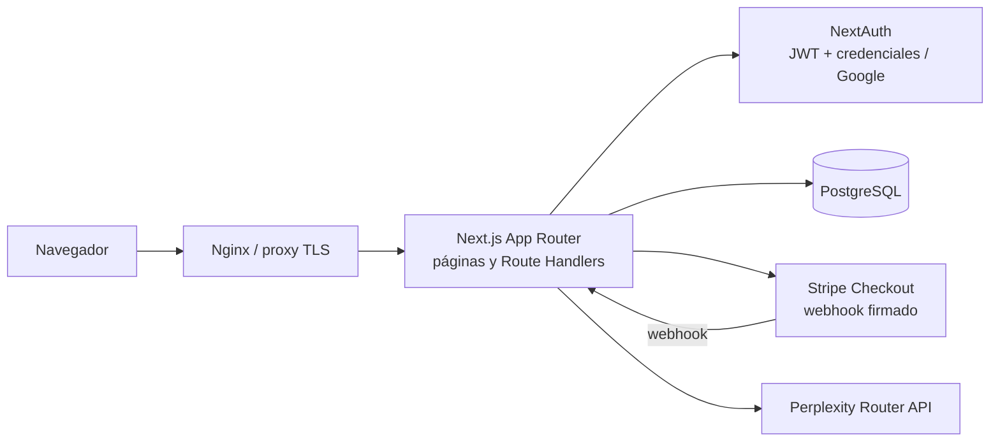

# Pezcado

**Pezcado** es una tienda online de pescado ficticio construida como proyecto full-stack. Combina un escaparate responsive con cuentas de usuario, carrito persistente, checkout de Stripe, gestión de pedidos y administración de cuentas.

El proyecto está pensado para demostrar decisiones de producto e ingeniería de extremo a extremo: validación en servidor, persistencia relacional, pagos confirmados por webhook, controles de acceso y despliegue en contenedores.

> **Estado:** proyecto de portfolio y demostración. Stripe está limitado a modo de prueba. Completa la información legal, comercial y de operación antes de aceptar ventas reales.

## Índice

- [Qué incluye](#qué-incluye)
- [Arquitectura](#arquitectura)
- [Flujos principales](#flujos-principales)
- [Rutas](#rutas)
- [Modelo de datos](#modelo-de-datos)
- [Tecnologías](#tecnologías)
- [Ejecución local](#ejecución-local)
- [Variables de entorno](#variables-de-entorno)
- [Pruebas y calidad](#pruebas-y-calidad)
- [Despliegue](#despliegue)
- [Decisiones y límites conocidos](#decisiones-y-límites-conocidos)
- [Estructura del repositorio](#estructura-del-repositorio)

## Qué incluye

- Catálogo de 19 productos con ilustraciones propias, precios almacenados en unidades menores de la moneda y una vista de colección responsive.
- Carrito en página independiente, accesible desde la navegación, con cantidades limitadas y persistencia en `localStorage`.
- Registro con contraseña y acceso con credenciales; Google OAuth es opcional. Las contraseñas se almacenan con hash bcrypt.
- Gestión de cuenta: edición del perfil, cambio de contraseña y cierre de cuenta con confirmación.
- Checkout con Stripe Checkout. El servidor vuelve a consultar el catálogo y calcula los importes; el navegador no determina los precios.
- Historial de pedidos asociado a la cuenta, y páginas de confirmación y cancelación.
- Panel de administración con búsqueda y paginación de cuentas, cambio de rol y activación/desactivación de acceso.
- Interfaz en español, inglés, francés y alemán; preferencia de idioma guardada en cookie.
- Páginas legales, consentimiento de cookies y métricas diarias agregadas opcionales.
- Chat de ayuda en servidor mediante Perplexity Router, configurable por variables de entorno.
- Página 404 propia y endpoints de salud para supervisión.

## Arquitectura

La aplicación usa el App Router de Next.js como frontend y backend: páginas y componentes de servidor consultan los datos directamente; Route Handlers exponen operaciones JSON a la interfaz, Stripe y herramientas de operación.



En desarrollo local, Docker Compose puede ejecutar PostgreSQL, la aplicación Next.js y Nginx. En una instalación sin contenedores, Next.js se puede iniciar directamente con `npm run dev`.

### Componentes y responsabilidades

| Área | Responsabilidad |
| --- | --- |
| `src/app/` | Páginas del App Router, endpoints HTTP y estilos globales. |
| `src/components/` | Cabecera, proveedores de sesión/carrito/idioma, consentimiento y chat compartidos. |
| `src/lib/` | Configuración de autenticación, Prisma, Stripe, carrito e internacionalización. |
| `prisma/` | Esquema relacional, migraciones, seed del catálogo y promoción inicial de administrador. |
| `e2e/` | Pruebas de flujos de navegador con Playwright. |
| `.github/workflows/ci.yml` | Tests, análisis estático y publicación de imagen en GHCR desde `main`. |
| `Dockerfile`, `docker-compose.yml`, `nginx/` | Imagen de producción y topología local con proxy inverso. |

## Flujos principales

### Compra

1. El navegador conserva identificadores de producto y cantidades en el carrito; nunca envía importes confiables.
2. `POST /api/checkout` valida la solicitud y requiere una sesión de usuario.
3. El servidor consulta productos activos en PostgreSQL, comprueba cantidades y moneda, calcula el total y crea un pedido `PENDING` con sus líneas e importes históricos.
4. Se crea una sesión de Stripe Checkout y se guarda su identificador asociado al pedido.
5. Stripe notifica el pago a `POST /api/webhooks/stripe`. El servidor verifica la firma del webhook y actualiza el pedido a `PAID` cuando el pago está completado.
6. La página de éxito comprueba también la sesión y el estado de pago antes de mostrar la confirmación y vaciar el carrito. Un enlace sin sesión válida se trata como no encontrado.

La página de retorno del navegador mejora la experiencia, pero no sustituye la verificación del webhook como fuente de confirmación del pago.

### Autenticación y autorización

- NextAuth usa sesiones JWT, con adaptador Prisma para persistencia de cuentas OAuth.
- El proveedor de credenciales compara el hash bcrypt; Google se habilita solo cuando están configurados ambos secretos OAuth.
- El rol se verifica en el servidor para operaciones administrativas. El cliente no decide sus permisos.
- `authVersion` permite invalidar sesiones JWT después de cambios sensibles de cuenta o administración.
- Las cuentas empiezan con rol `USER`. El primer administrador se promueve mediante un comando operativo explícito.

### Carrito

`CartProvider` centraliza el estado compartido entre páginas y sincroniza sus líneas con `localStorage`. El carrito contiene referencias y cantidades, no precios de confianza; los precios y disponibilidad se resuelven en el servidor al iniciar el checkout.

## Rutas

### Páginas

| Ruta | Descripción |
| --- | --- |
| `/` | Portada, productos destacados y catálogo. |
| `/cart` | Carrito y resumen del pedido. |
| `/account` | Registro e inicio de sesión. |
| `/account/settings` | Perfil, contraseña y cierre de cuenta. |
| `/orders` | Historial del usuario autenticado. |
| `/admin/accounts` | Gestión de cuentas para administradores. |
| `/order/success` | Confirmación verificada de un pago. |
| `/order/cancelled` | Retorno informativo de un checkout cancelado. |
| `/privacy`, `/cookies`, `/terms` | Información legal y configuración de consentimiento. |
| Cualquier ruta desconocida | Página 404 de marca. |

### API

| Método y ruta | Uso |
| --- | --- |
| `GET /api/products` | Catálogo de productos activos. |
| `POST /api/register` | Registro con validación de datos y hash de contraseña. |
| `PATCH, DELETE /api/account` | Actualizar perfil o contraseña; cerrar la cuenta autenticada. |
| `POST /api/checkout` | Crear pedido pendiente y sesión de Stripe Checkout. |
| `POST /api/webhooks/stripe` | Validar eventos firmados y reflejar pagos completados. |
| `GET, PATCH /api/admin/users` | Buscar/paginar cuentas y cambiar su rol o estado; requiere administrador. |
| `POST /api/metrics` | Incrementar métricas agregadas solo con consentimiento válido. |
| `POST /api/chat` | Enviar una conversación validada al proveedor configurado, con límite por cliente. |
| `/api/auth/[...nextauth]` | Flujos de autenticación de NextAuth. |
| `GET /api/health/live` | Liveness del proceso. |
| `GET /api/health/ready` | Readiness con consulta real a PostgreSQL; devuelve `503` si no está disponible. |

## Modelo de datos

Definido en [`prisma/schema.prisma`](./prisma/schema.prisma) y versionado en [`prisma/migrations/`](./prisma/migrations/).

| Modelo | Propósito |
| --- | --- |
| `User` | Identidad, credenciales, rol, estado de acceso y versión de autenticación. |
| `Account`, `Session`, `VerificationToken` | Modelos de soporte del adaptador de NextAuth. La aplicación usa sesiones JWT. |
| `Product` | Catálogo, slug, disponibilidad, moneda y precio en unidades menores (por ejemplo, céntimos). |
| `Order` | Comprador, estado, total y referencia única de sesión de Stripe. |
| `OrderItem` | Cantidad y copia del precio unitario en el momento de la compra. |
| `DailyPageMetric` | Contador por fecha y ruta, sin identidad de visitante. |
| `RateLimitBucket` | Contador temporal por identificador seudonimizado para limitar login y chat entre instancias. |

Los estados de pedido son `PENDING`, `PAID` y `CANCELLED`; los roles son `USER` y `ADMIN`. Los pedidos pueden conservarse al eliminar una cuenta, desvinculándolos y sustituyendo los datos de correo según la lógica de cierre de cuenta.

## Tecnologías

- **Aplicación:** Next.js 16, React 19, TypeScript.
- **Datos:** PostgreSQL, Prisma 7 y adaptadores PostgreSQL/Neon.
- **Identidad:** NextAuth, credenciales, bcrypt y Google OAuth opcional.
- **Pagos:** Stripe Checkout y webhooks firmados.
- **Validación:** Zod.
- **Asistente:** SDK OpenAI Chat Completions apuntando al endpoint de Perplexity Router.
- **Calidad:** Vitest, Playwright, TypeScript, GitHub Actions, npm audit y CodeQL.
- **Operación:** Docker multi-stage, Docker Compose y Nginx.

## Ejecución local

### Requisitos

- Node.js 22 o superior y npm.
- Docker con Docker Compose, para iniciar PostgreSQL local.
- Una cuenta de Stripe en modo de prueba para verificar el flujo de pago.

### Preparar la aplicación

```bash
npm ci
cp .env.example .env
```

Edita `.env` para el entorno local. Usa una base local, una clave aleatoria para `AUTH_SECRET` y claves de prueba de Stripe. Por ejemplo, genera el secreto con:

```bash
openssl rand -base64 32
```

Inicia la base de datos, aplica las migraciones, crea los productos de demostración y ejecuta Next.js:

```bash
docker compose up -d db
npm run db:generate
npm run db:deploy
npm run db:seed
npm run dev
```

Abre [http://localhost:3000](http://localhost:3000). Para iniciar sesión localmente basta el proveedor de credenciales; Google OAuth y el chat son opcionales. Si no configuras Stripe, el checkout no podrá crear sesiones.

### Probar webhooks de Stripe

Instala Stripe CLI, inicia sesión y reenvía los eventos al endpoint local:

```bash
stripe listen --forward-to localhost:3000/api/webhooks/stripe
```

Configura el valor `whsec_...` mostrado por Stripe CLI como `STRIPE_WEBHOOK_SECRET`. Usa una tarjeta de prueba de Stripe, por ejemplo `4242 4242 4242 4242`, con cualquier fecha futura y CVC de tres dígitos.

### Docker Compose con Nginx

La configuración Compose utiliza PostgreSQL, un servicio de migración de mantenimiento, la aplicación Next.js y Nginx. Configura en `.env` las variables requeridas `AUTH_SECRET` y `NEXT_PUBLIC_APP_URL`; para desarrollo local, usa la URL `http://localhost:3000`. Nginx sobrescribe `X-Real-IP` y Compose activa `TRUST_PROXY_IP_HEADERS` para limitar solicitudes por IP.

```bash
docker compose up -d db
docker compose run --rm migrate
docker compose up -d --build app nginx
docker compose exec app npm run db:seed
docker compose ps
docker compose logs -f app
```

La tienda queda publicada en el puerto `3000` del host a través de Nginx. Para detener los servicios sin borrar los datos de PostgreSQL:

```bash
docker compose down
```

## Variables de entorno

La plantilla es [`.env.example`](./.env.example). No subas `.env`, claves ni cadenas de conexión al repositorio.

| Variable | Uso |
| --- | --- |
| `DATABASE_URL` | Conexión usada por la aplicación. En Neon, usa la URL pooled. |
| `DIRECT_URL` | Conexión directa para Prisma CLI y migraciones; puede coincidir con `DATABASE_URL` en local. |
| `AUTH_SECRET` | Secreto fuerte para NextAuth/JWT; debe ser el mismo en todas las instancias. |
| `NEXTAUTH_URL` | URL pública canónica de autenticación. |
| `NEXTAUTH_URL_INTERNAL` | URL interna opcional para conexiones desde el servidor; en Compose es `http://app:3000`. |
| `NEXT_PUBLIC_APP_URL` | URL pública para enlaces y redirecciones de Stripe. En producción debe ser HTTPS, no localhost. |
| `STRIPE_SECRET_KEY` | Clave secreta de Stripe. Esta aplicación está diseñada para claves de prueba. |
| `STRIPE_WEBHOOK_SECRET` | Secreto para comprobar la firma del webhook. |
| `GOOGLE_CLIENT_ID`, `GOOGLE_CLIENT_SECRET` | Credenciales OAuth opcionales; Google se habilita si están ambas presentes. |
| `PERPLEXITY_API_KEY` | Clave de servidor opcional para el chat. Nunca debe llevar prefijo `NEXT_PUBLIC_`. |
| `PERPLEXITY_ROUTER_MODEL` | ID de modelo permitido para esa clave en Perplexity Router. |
| `DATABASE_POOL_MAX` | Tamaño del pool del adaptador PostgreSQL, entero entre 1 y 100; predeterminado `1`. |
| `TRUST_PROXY_IP_HEADERS` | Debe ser `true` solo cuando un proxy de confianza sobrescriba las cabeceras de IP. Predeterminado `false`; Compose lo activa detrás de Nginx. |
| `DEPLOYMENT_VERSION` | Identificador de compilación/versión usado por la imagen. |

`VERCEL_URL` se utiliza como alternativa para detectar la URL desplegada cuando no se ha configurado una URL pública explícita. Configura `NEXT_PUBLIC_APP_URL` y `NEXTAUTH_URL` de forma coherente en producción; Stripe no debe recibir una dirección localhost para una tienda pública.

### Habilitar Google OAuth

Registra un cliente OAuth de tipo Web en Google Cloud Console. Añade como URI de redirección:

```text
https://<tu-dominio>/api/auth/callback/google
```

Para desarrollo local, añade también:

```text
http://localhost:3000/api/auth/callback/google
```

Configura el ID y el secreto de cliente en el entorno del servidor. El dominio debe coincidir con `NEXTAUTH_URL`.

### Habilitar el asistente

Configura `PERPLEXITY_API_KEY` y un `PERPLEXITY_ROUTER_MODEL` permitido por el catálogo asociado a esa clave. Router puede requerir habilitación del proveedor y los modelos disponibles dependen de la cuenta. El endpoint limita el tamaño de solicitud, el número de mensajes y las peticiones por dirección de cliente. La aplicación ignora las cabeceras de IP salvo que `TRUST_PROXY_IP_HEADERS=true`; activa esa opción solo detrás de un proxy controlado que sobrescriba `X-Real-IP` o `X-Forwarded-For`. Sin proxy confiable, el chat cae en un bucket compartido, por lo que se recomienda desplegarlo detrás de uno.

## Pruebas y calidad

```bash
npm run typecheck
npm test
npx playwright install chromium
npm run test:e2e
npm run build
```

- **Vitest:** utilidades y endpoints, con casos de errores y validaciones.
- **Playwright:** navegación, catálogo, carrito, cuenta, páginas legales, consentimiento y smoke tests. Para los casos que necesitan base de datos, prepara PostgreSQL, migraciones y seed; el flujo de pago depende además de credenciales de prueba de Stripe.
- **Build y tipos:** verificados con el build de producción y el chequeo TypeScript.

GitHub Actions ejecuta typecheck, tests unitarios, build, e2e, `npm audit` y CodeQL. En pull requests también revisa dependencias nuevas. Al hacer push a `main`, si pasan los jobs requeridos, construye y publica una imagen en GitHub Container Registry con etiqueta por commit y `latest`.

## Despliegue

### Docker y proxy inverso

El [`Dockerfile`](./Dockerfile) crea una imagen multi-stage de Next.js standalone y ejecuta el proceso como usuario sin privilegios. En Compose, Nginx expone el servicio y espera a que la app pase readiness. Para tráfico público, termina TLS en un proxy/balanceador con certificado válido y define la URL HTTPS pública en las variables.

Los endpoints de operación son:

- `GET /api/health/live`: el proceso está respondiendo.
- `GET /api/health/ready`: el proceso puede consultar PostgreSQL.

### Base de datos y migraciones

Para PostgreSQL administrado, configura `DATABASE_URL` y `DIRECT_URL` desde el mismo proyecto/base/rol. Prisma CLI utiliza `DIRECT_URL` cuando existe. En Neon, usa la cadena pooled para la aplicación y la cadena directa para migraciones.

Después de modificar el esquema:

```bash
npm run db:migrate -- --name nombre_del_cambio
```

En el despliegue, aplica migraciones pendientes con:

```bash
npm run db:deploy
```

Ejecuta las migraciones **una sola vez por despliegue**, antes de activar la nueva versión; no las ejecutes simultáneamente desde cada réplica. `npm run db:seed` es idempotente y carga/actualiza el catálogo de demostración. La migración de `RateLimitBucket` también debe aplicarse antes de activar la versión que limita login y chat.

### Limpiar pedidos pendientes antiguos

`npm run orders:cleanup-pending` elimina pedidos con estado `PENDING` creados hace más de 24 horas; las líneas se eliminan por la relación en cascada. Programa el comando en un scheduler (por ejemplo, cada hora) con `DATABASE_URL` apuntando a la base de datos correcta. No afecta pedidos pagados ni cancelados.

Para despliegues de producción con Vercel, `npm run vercel-build` ejecuta migraciones y seed cuando `VERCEL_ENV=production`, y después compila Next.js. Asegúrate de que `DIRECT_URL` y `DATABASE_URL` estén disponibles durante ese build y ten presente que las migraciones se aplican antes de publicar la nueva compilación.

### Varias instancias

Todas las réplicas deben compartir la misma base de datos, `AUTH_SECRET` y URL pública. No se requieren sesiones sticky porque la sesión de NextAuth es JWT. Configura el balanceador para conservar cookies y reenviar los encabezados de host/protocolo. Ajusta `DATABASE_POOL_MAX` según el límite de conexiones de PostgreSQL y el número de instancias. Compose está pensado para una instancia local; la orquestación de réplicas y TLS debe configurarse en la plataforma de despliegue.

## Decisiones y límites conocidos

- **Importes del lado servidor:** se evita confiar en precio/currency enviados por el cliente; se usan datos de PostgreSQL para construir las líneas de Stripe.
- **Confirmación de pago:** webhook con firma verificada más comprobación de la sesión al volver a la página de éxito. Los pedidos comienzan en estado pendiente.
- **Unidades menores para dinero:** se guardan importes enteros para evitar errores de redondeo en cálculos con decimales.
- **Sesiones revocables:** `authVersion` permite invalidar JWT existentes tras cambio de contraseña o actualización administrativa.
- **Estado de carrito en cliente:** ofrece continuidad entre páginas sin crear un carrito persistido en base de datos; un dispositivo/navegador mantiene su propio carrito.
- **Métricas mínimas:** las métricas opcionales se agregan por día y ruta, y requieren consentimiento explícito.
- **Límites de solicitudes:** login y chat usan contadores de ventana fija persistidos en PostgreSQL, con claves SHA-256 y limpieza oportunista de buckets expirados. Login permite 30 intentos por correo cada 15 minutos y, con proxy confiable, otros 10 por combinación correo/IP. Chat permite 10 solicitudes por IP por minuto. La ventana fija puede permitir hasta el doble de intentos al cruzar el borde entre ventanas; es un compromiso sencillo para este proyecto.
- **Confianza en la IP:** las cabeceras se ignoran por defecto. Activa `TRUST_PROXY_IP_HEADERS=true` solo detrás de un proxy controlado que las sobrescriba; sin proxy, la cuota IP del chat comparte un bucket entre clientes.
- **Pedidos pendientes:** si Stripe falla después de crear el pedido, puede quedarse en `PENDING`. `npm run orders:cleanup-pending` elimina los pendientes de más de 24 horas cuando se programa en un scheduler; la aplicación no incluye un scheduler embebido.
- **Legal y comercio:** los textos legales son un borrador técnico. Completa identidad del responsable, contacto, países de venta, envíos, devoluciones y demás obligaciones antes de operar.
- **Stripe:** el proyecto rechaza el uso de claves live y no está preparado como tienda de producción para cobros reales.

## Estructura del repositorio

```text
.
├── .github/workflows/ci.yml    # CI, análisis y publicación de imagen
├── e2e/                        # Pruebas Playwright
├── nginx/                      # Configuración del proxy inverso
├── prisma/
│   ├── migrations/             # Historial de cambios del esquema
│   ├── schema.prisma           # Modelos y relaciones
│   ├── seed.ts                 # Catálogo inicial de demostración
│   └── promote-admin.ts        # Promoción controlada de administrador
├── public/peces/               # Ilustraciones del catálogo
├── src/
│   ├── app/                    # Páginas y Route Handlers
│   ├── components/             # UI y proveedores compartidos
│   ├── generated/prisma/       # Cliente Prisma generado
│   ├── lib/                    # Integraciones y lógica compartida
│   └── types/                  # Extensiones de tipos
├── Dockerfile
├── docker-compose.yml
└── README.md
```

El nombre público del producto y el paquete npm es **Pezcado**. El repositorio remoto y los nombres históricos de variables/cookies conservan `fish-store` por compatibilidad.

## Presentación breve para entrevista

> Construí una tienda full-stack con Next.js y TypeScript, PostgreSQL y Prisma. Implementé autenticación con NextAuth y roles administrativos; checkout de Stripe con precios calculados en servidor y confirmación por webhook firmado; y pruebas con Vitest y Playwright. También preparé despliegue en contenedores con Nginx, health checks y CI en GitHub Actions. Una decisión clave fue separar la redirección de Stripe de la confirmación autoritativa del pago, que depende de eventos verificados y del estado persistido del pedido.
